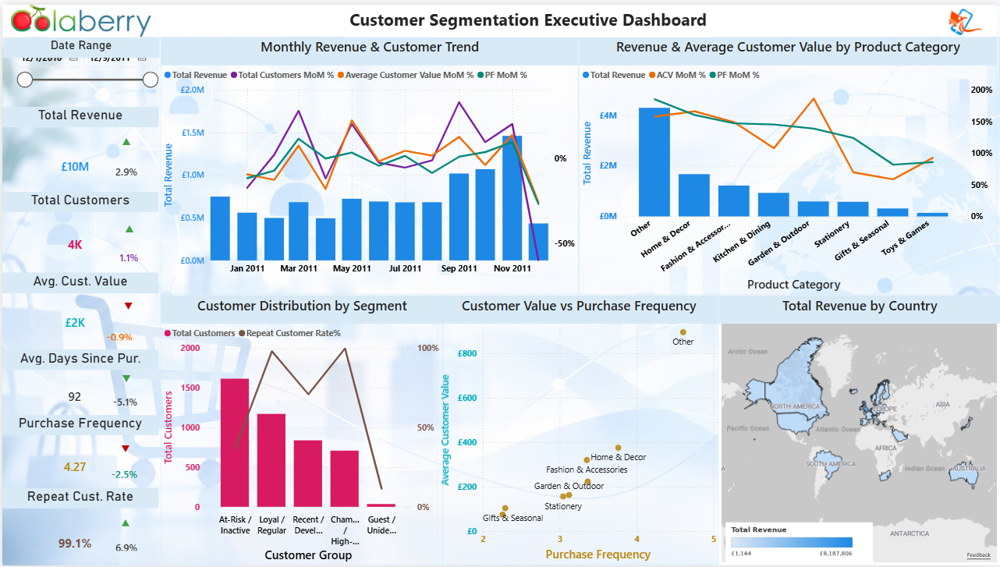

# Online Retail Customer Segmentation

Customer segmentation analysis using Python, RFM analysis, K-Means clustering, and Power BI.

## 📌 Project Overview

This project analyzes online retail transaction data to identify customer purchasing patterns and create meaningful customer segments.

The analysis combines Python-based data preparation and customer segmentation with Power BI reporting to transform transactional data into actionable business insights.

## 🎯 Business Objective

 The goal of this project is to:

- Understand customer purchasing behavior

- Identify high-value and repeat customers

- Segment customers based on purchasing patterns

- Analyze revenue and customer trends

- Build an interactive dashboard for business decision-making

## 📊 Dataset

 Dataset: Online Retail Dataset

- The dataset contains transactional information from an online retail business, including:

- Invoice

- Stock Code

- Product Description

- Quantity

- Invoice Date

- Unit Price

- Customer ID

- Country

## 🛠️ Tools & Technologies

 Data Analysis & Machine Learning

- Python

- Pandas

- NumPy

- Scikit-learn

- Jupyter Notebook

- Business Intelligence

- Power BI

- DAX

- Power Query

- Data Analysis Techniques

- Data Cleaning

- Exploratory Data Analysis

- RFM Analysis

- K-Means Clustering

- Customer Segmentation

- Data Visualization

## 🔄 Project Workflow

1. Data Preparation

The transaction data was cleaned and prepared for analysis by addressing missing values, reviewing data types, and preparing the dataset for customer-level analysis.

2. RFM Analysis

- Customer behavior was evaluated using three key metrics:

- Recency — How recently a customer made a purchase.

- Frequency — How often a customer made a purchase.

- Monetary — How much a customer spent.

- These measures were used to develop customer-level purchasing profiles.

3. Customer Segmentation

- K-Means clustering was applied to group customers with similar purchasing behaviors.

- The resulting segments help distinguish different customer profiles based on their purchasing activity and value.

4. Power BI Dashboard

- An interactive Power BI dashboard was developed to communicate the analysis and support business decision-making.

- The dashboard includes:

- Total Revenue

- Total Customers

- Average Customer Value

- Purchase Frequency

- Average Days Since Purchase

- Repeat Customer Rate

- Monthly Revenue and Customer Trends

- Customer Distribution by Segment

- Customer Value and Purchase Frequency Analysis

- Product Category Analysis
  
## 📊 Power BI Dashboard
 The interactive Power BI dashboard provides an executive-level view of customer behavior, revenue trends, customer value, purchase frequency, customer segments,  and geographic revenue distribution.
 
 
## 📈 Key Analysis Areas

- Customer Value

- Analyzes customer spending patterns and identifies differences in customer value across segments.

- Purchase Frequency

- Examines how frequently customers purchase and helps identify repeat purchasing behavior.

- Customer Segmentation

- Uses clustering results to categorize customers based on purchasing behavior.

- Revenue Trends

- Analyzes changes in revenue over time using monthly reporting.

##💡 Business Value

 This analysis can help businesses:

- Identify valuable customer groups

- Improve customer retention strategies

- Develop targeted marketing campaigns

- Understand purchasing behavior

- Prioritize high-value customers

- Support data-driven business decisions

## 📁 Project Files
## 📥 Power BI Project File

You can download the Power BI Desktop project file here:

[Download the Power BI Dashboard (.pbix)](Customer%20Segment%20Dashboard%20Revised.pbix) 
Additional project files and visualizations will be added to this repository as the portfolio is developed.

## 👩‍💻 Author

Saba Gebremichael

Data Analyst | Power BI | SQL | Business Intelligence

📧 seiona1212@gmail.com

🔗 GitHub: https://github.com/SabaGebremichael

This project was developed as part of my data analytics and business intelligence training and portfolio development.
